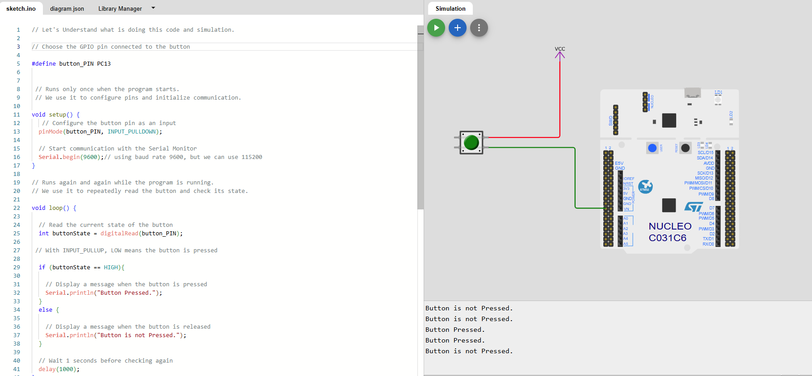

# Lab 3 -- STM32 GPIO Input With Internal Pull-Down Resistor

## Overview
In this lab, we learn how to configure an STM32 GPIO pin as a digital input using an internal pull-down resistor. We will use the Wokwi simulator to read the state of a push button without needing physical hardware.

## Objectives
- Understand the purpose of a pull-down resistor.
- Configure a GPIO pin using INPUT_PULLDOWN.
- Read a push button using digitalRead().
- Observe the difference between button-pressed and button-released states.

## Tools Used
- STM32 Nucleo board in Wokwi
- Arduino programming framework
- Wokwi online simulator

## Circuit Diagram

